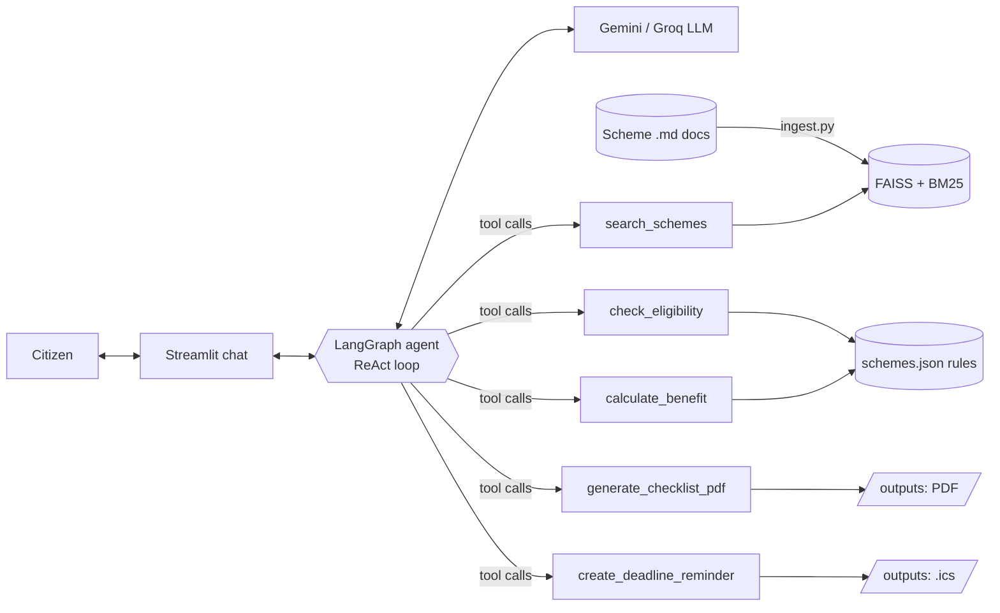

# YojanaMitra AI 🇮🇳

**An AI agent that tells Indian citizens which government schemes they qualify for, how much they would get, and what to bring. It then creates their document checklist and application reminder.**

India runs over 1,000 central and state welfare schemes, but the rules are buried in long PDFs spread across portals. Many eligible farmers, students, women and small-business owners never apply. YojanaMitra turns a plain-language description ("I'm a 21-year-old student from rural Maharashtra, family income 2.4 lakh, my father owns farmland") into a clear list of schemes, rupee amounts, documents and next steps.

Built by **Manjushri Gangasagar** for the Generative AI course project at Ajeenkya DY Patil University, Pune.

**Live web preview:** [YojanaMitra AI — Live Agent Preview](https://claude.ai/artifact/VSHHko4opucNPkfGy1oe2S). It's the same agent design, five tools, rules and documents running in the browser on Claude (this repository's app uses Gemini, and its retrieval adds MiniLM semantic search).

## Features

| Requirement | How YojanaMitra does it |
|---|---|
| **Generative AI** | Gemini (or Llama 3.3 via Groq) understands the user and writes a cited, multilingual answer |
| **RAG** | Scheme documents → header-aware chunks → MiniLM embeddings → FAISS, fused with BM25 keyword search (hybrid retrieval) |
| **Tool calling** | 5 Python tools: scheme search, eligibility check, benefit calculator, checklist PDF, calendar reminder |
| **AI agent** | Explicit LangGraph ReAct graph: the LLM picks tools, LangGraph runs them, loops until done; conversation memory per user |

The app has three pages:

- **Home:** chat with the agent. Each tool call shows live, and checklist PDFs download from the chat.
- **Scheme Explorer:** browse and filter the 8 schemes, with eligibility routes, documents and official sources.
- **Evaluation:** a dashboard that runs the test cases live (eligibility accuracy, retrieval Hit@4 and MRR).

## Architecture



**Why the rules are a tool and not left to the LLM.** Eligibility depends on exact thresholds (age 21-65, income ≤ ₹2.5 lakh). Code is deterministic and testable, while LLMs can misjudge limits. The LLM handles language and reasoning, and the tools handle facts and arithmetic.

**Why hybrid retrieval.** Semantic search finds paraphrases ("cooking gas for poor women" → Ujjwala). BM25 catches exact names and terms ("EDP training", "Vay Vandana"). Reciprocal-rank fusion merges both lists.

## Tools

| Tool | What it does |
|---|---|
| `search_schemes(query)` | Hybrid RAG search; returns top-4 passages tagged `[Source: file.md]` |
| `check_eligibility(age, gender, income, category, occupation, state, area, flags)` | Rule engine over `schemes.json`; returns *Eligible*, *Likely eligible (verify)* and *Not eligible, with the reason* |
| `calculate_benefit(scheme_ids, ...)` | Yearly cash total, one-time support, and the PMEGP subsidy (15-35% by category and area, capped by sector) |
| `generate_checklist_pdf(name, scheme_ids)` | PDF with benefits, document checkboxes, how to apply and sources |
| `create_deadline_reminder(scheme_id, date)` | `.ics` calendar event with an alert one day before |

## Schemes covered (8)

PM-KISAN · Ayushman Bharat PM-JAY · PM Ujjwala Yojana · PMEGP · Post-Matric Scholarship (SC) · Sukanya Samriddhi Yojana · Majhi Ladki Bahin Yojana (Maharashtra) · PMAY-Gramin

To add a scheme, add one `.md` file in `data/schemes/` and one entry in `data/schemes.json`, then re-run `python ingest.py`.

## Setup

**Quick start:** double-click `run.bat` (Windows) or run `./run.sh` (macOS/Linux). It creates the environment, asks for your key, builds the index and opens the app.

Manual steps:

```bash
git clone https://github.com/manjushrigangasagar0304/yojanamitra-ai.git
cd yojanamitra-ai
python -m venv venv && source venv/bin/activate      # Windows: venv\Scripts\activate
pip install -r requirements.txt
cp .env.example .env                                 # then paste your free Gemini key
python ingest.py                                     # builds the vector store (downloads MiniLM once)
streamlit run Home.py
```

Free API keys: Gemini at [aistudio.google.com/apikey](https://aistudio.google.com/apikey), or Groq at [console.groq.com/keys](https://console.groq.com/keys) (then set `LLM_PROVIDER=groq`).

Terminal demo without the UI: `python agent.py`

## Evaluation

```bash
python -m pytest -q              # 5 tests, incl. a full agent tool-loop with a scripted LLM (no API key)
python eval/evaluate.py          # eligibility accuracy + retrieval Hit@4 / MRR
python eval/evaluate.py --agent  # + end-to-end agent scheme recall (uses the LLM)
```

| Metric | Result |
|---|---|
| Eligibility exact match (10 personas, incl. edge cases: age 20 vs 21, income above limit, wrong state) | 10/10 |
| Retrieval Hit@4 (12 queries) | 12/12, MRR 0.75 |
| End-to-end agent scheme recall (10 personas) | [run `--agent` and fill in] |

## Project structure

```
├── Home.py              Streamlit chat page (shows each tool call live, download buttons)
├── pages/               Scheme Explorer and Evaluation dashboard pages
├── agent.py             LangGraph agent + system prompt
├── tools.py             the 5 tools + rule engine + hybrid retriever
├── ingest.py            builds the FAISS index
├── config.py            paths, embeddings, LLM provider
├── data/schemes/        knowledge base (one markdown file per scheme)
├── data/schemes.json    structured eligibility rules and amounts
├── eval/                evaluation cases and script
└── tests/               pytest suite
```

## Limitations and next steps

- 8 schemes only; scaling to all 1,000+ would mean ingesting myScheme data automatically.
- Scheme rules change. Figures were checked in November 2026; always confirm on the official portal.
- Some routes (PM-JAY for under-70s, Ujjwala) depend on government lists the app can't access, so they show as "likely eligible".
- Next: voice input in Hindi/Marathi, WhatsApp bot, a live web-search tool for deadline changes, and deployment on Streamlit Community Cloud.

## Tech stack

Python · LangChain · LangGraph · Gemini / Groq · FAISS · BM25 · sentence-transformers (MiniLM) · fpdf2 · Streamlit · pytest

*Not an official government service. Information is for guidance only.*
